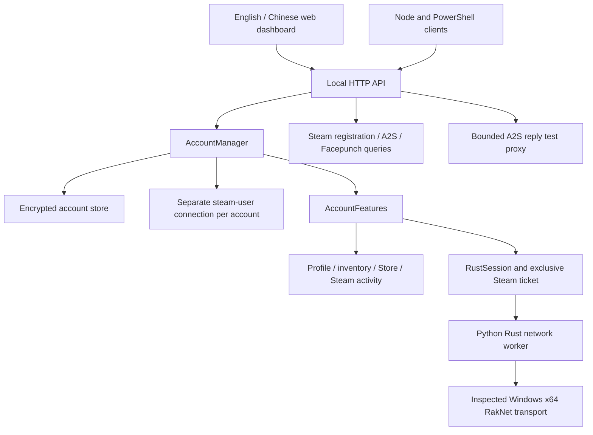

# Code Guide

[Project README](../README.md) · [Service and API](../steam-multi-account/README.md) · [Research direction](RESEARCH.md)

This guide explains the code as it exists for the 2026-10-27 publication. It describes observable behavior and extension points; dated reports retain the build/configuration limits of each experiment.

## Application structure



The browser is a management interface. Closing it does not close the Node service. The service owns Steam sessions and any network workers. Each account has its own Steam connection and exclusive ticket lifecycle; no single official Rust client process is shared among the accounts.

## Source map

Paths in this table are relative to `steam-multi-account/` unless otherwise stated.

| File | Responsibility |
| --- | --- |
| `src/server.js` | Process startup, data-directory lock, Steam client/network configuration, local listener, restoration, and graceful shutdown |
| `src/http.js` | Static assets, local Host/Bearer/same-origin checks, JSON limits, account/Rust/query routes, and close cleanup |
| `src/accounts.js` | Account records, login and Guard transitions, persistence, reconnect policy, logout, and removal |
| `src/store.js` | Atomic AES-256-GCM storage, Windows DPAPI key handling, and random local API key creation |
| `src/features.js` | Per-account profile/library/inventory/license/Steam activity operations and access to Rust features |
| `src/catalog.js` | Free-game Store search and result pagination |
| `src/network.js` | HTTP proxy selection and Steam/web network adapters |
| `src/game-auth.js` | Exclusive Rust ticket issuance, validation observations, and cancellation ownership |
| `src/rust-connection.js` | Native-runtime validation, Python worker launch/control, permitted result schema, bounded probes, and action/chat communication |
| `src/rust-session.js` | Persistent Rust state transitions, safe snapshots, stop/error handling, ticket cleanup, and Steam activity restoration |
| `src/rust-actions.js` | Fixed action names, confirmation requirements, and permitted result states |
| `src/rust-workspace.js` | Batch import/connect/login/disconnect jobs, connection spacing, local server groups, and recent account events |
| `src/rust-server-query.js` | Server information used by Rust session/group views |
| `src/rust-public-query.js` | Exact Steam query-port discovery, A2S comparisons, Facepunch map fetch/cache, and per-source error handling |
| `src/rust-query-proxy.js` | A2S request filtering, stable upstream sockets, challenge forwarding, split reassembly, marked test entries, and socket cleanup |
| `src/rust-auth-association.js` | Experimental correlation of one active ticket and actual game-server identity; not wired into ordinary sessions |
| `public/` | Dashboard markup, rendering, language support, styles, and project/research explanations |
| `client.js` | Local HTTP SDK; it reads the API key locally but does not contain account credentials |
| `scripts/steam.ps1` | Interactive PowerShell client with hidden password input |
| `scripts/configure-rust-runtime.mjs` | Validate and save machine-local Python/DLL paths and matching hash |
| `test/` | Node fixtures for account logic, features, storage, routes, worker integration boundaries, and queries |

The repository's `tools/rust-research/` directory contains `rust-peer.py`, `rust_packet_codec.py`, player-state/input helpers, offline analysis, capture/diagnostic scripts, and their checks. `rust-research/query-server.mjs` is the dependency-free A2S parser/client reused by the application and standalone proxy.

## Steam account lifecycle

An internal account ID is distinct from its Steam login name. The service validates IDs, prevents duplicate account names, and creates a separate `steam-user` client for each account. A successful login sets an online persona and saves renewable credentials, not the password or Guard code.

The main states are `offline`, `connecting`, `guard_required`, `online`, `reconnecting`, and `error`. Guard submission uses the callback belonging to that account's current attempt; cooldown metadata lets the caller wait for a fresh mobile code. A terminal authentication error does not cause unlimited credential retries.

Saved `autoConnect` controls restoration. Startup spreads logins across time instead of submitting every account simultaneously. Logout disables restoration while retaining the saved record. `DELETE /v1/accounts/{id}` removes that local record, persists the new store, and disconnects its features/client; it does not delete a Steam account at Valve.

The store uses an authenticated encrypted envelope and atomic replacement. A data-directory lock prevents simultaneous processes from rotating tokens or overwriting the same store. On Windows, DPAPI binds the encryption key to the current Windows user/machine. The HTTP API never returns stored refresh tokens or web cookies.

## Rust session and worker lifecycle

Before issuing a game ticket, the service validates the destination and native runtime. A supported complete DLL hash and x64 PE format are required; a matching export name alone does not establish ABI compatibility. The worker receives its ticket over an anonymous pipe and returns a restricted metadata schema.

The useful stages are:

```text
Steam online
  -> exclusive Rust ticket acquired
  -> native transport connected
  -> identity requested and submitted
  -> approval accepted for supported level 0/1
  -> Ready sent
  -> own player entity observed
  -> exact own FinishLoading observed
  -> entered_game
```

Transport connection is earlier than identity approval, and approval is earlier than confirmed player admission. The implementation stops on EAC requirements and protected/unsupported encryption above level 1. Level-1 protocol obfuscation is not EAC. The state API continues to report `eacVerified: false`.

Stopping ends pending actions, closes the worker/native peer, waits for worker exit, then cancels/clears its Steam ticket and restores saved activity reporting. Keep that ordering when changing lifecycle code. A ticket must not be made available to another worker while the old network owner can still use it.

Historical `entered_game` and own-state observations can become stale. Rendering preserves their age and marks ended connections as history. Do not infer current admission from an old snapshot or replace missing state with a positive result.

## Role actions

Actions are fixed operations rather than arbitrary console execution. `rust-actions.js` validates `wake`, `respawn`, `suicide`, `stop`, directional short steps, and `jump`. Death and movement have explicit confirmation fields. The worker gates actions using the same own entity, precise FinishLoading, complete ordered recent snapshots, and supported posture/state.

Wake uses a short full-input sequence with release handling. After any wake Tick starts server responsiveness timing, a separate ordinary keepalive RPC maintains the connection. A long scheduler stall or failure to release safely closes that account's connection instead of reusing stale coordinates or burst-sending missed input. Small movement traces do not include complete map collision or game physics.

API acceptance, native transport send, a subsequent snapshot, and server-side confirmation are separate events. Chat/action output should keep those distinctions; global chat reception was verified separately using server records in historical tests.

## Population data paths

`rust-public-query.js` compares data sources without merging their meanings:

| Source | What it reports |
| --- | --- |
| This service's overview | Accounts and Rust sessions currently managed by this Node process |
| Server active-player/connection diagnostics | Server-side internal state at the observation time |
| A2S_INFO | Player/bot/max counts and optional Rust tags published by the query endpoint |
| A2S_PLAYER | Server-provided public names/scores/durations; no verified SteamID roster |
| Rust `cp` tag | The server's published tag value, preserved separately from the A2S player byte |
| Steam GMS/server-list query | Steam's corresponding source; fields are not automatically authenticated-player counts |
| Facepunch public map | Aggregate count for a game endpoint in a particular cached public batch |

Missing entries and failed requests remain unknown. The public-query form uses exact Steam registration discovery or an explicitly supplied query port; it does not scan adjacent ports. Facepunch requests are cached and merged, with `Last-Modified`, `Age`, and observation time retained to identify repeated reads of one batch.

The A2S proxy accepts only query datagrams, reuses the upstream socket for each querying client so challenge round trips retain their source port, and bounds clients, request rate, timeouts, fragments, and reply size. It preserves genuine entries and `cp`, and appends clearly named test records. It does not create players or EAC sessions. Public UDP routing is outside the local dashboard's loopback proxy and must be verified independently.

## Where to make changes

- Add an account feature in `features.js`, expose it in `http.js`, and render it in the relevant dashboard view. Keep secrets out of API snapshots and logs.
- Change persistent connection transitions in `rust-session.js`; change native/worker protocol communication in `rust-connection.js` and the Python worker together.
- Extend actions through the fixed allowlist and guarded worker path. Preserve fresh-state and release/cleanup conditions.
- Add a population source to `rust-public-query.js` as its own result with its own errors and timestamps. Do not silently substitute it for another source.
- Add server-side diagnostics under `server-upload/` with explicit deployment, removal, and version requirements. These are separate artifacts from the local Node process.

Use the existing meaningful fixture suites for lifecycle, parsing, and network-boundary changes. Syntax/fixture success cannot replace an authorized live experiment for current Rust/EAC behavior. See [the research guide](RESEARCH.md) for the evidence required before changing a capability from unresolved to verified.
