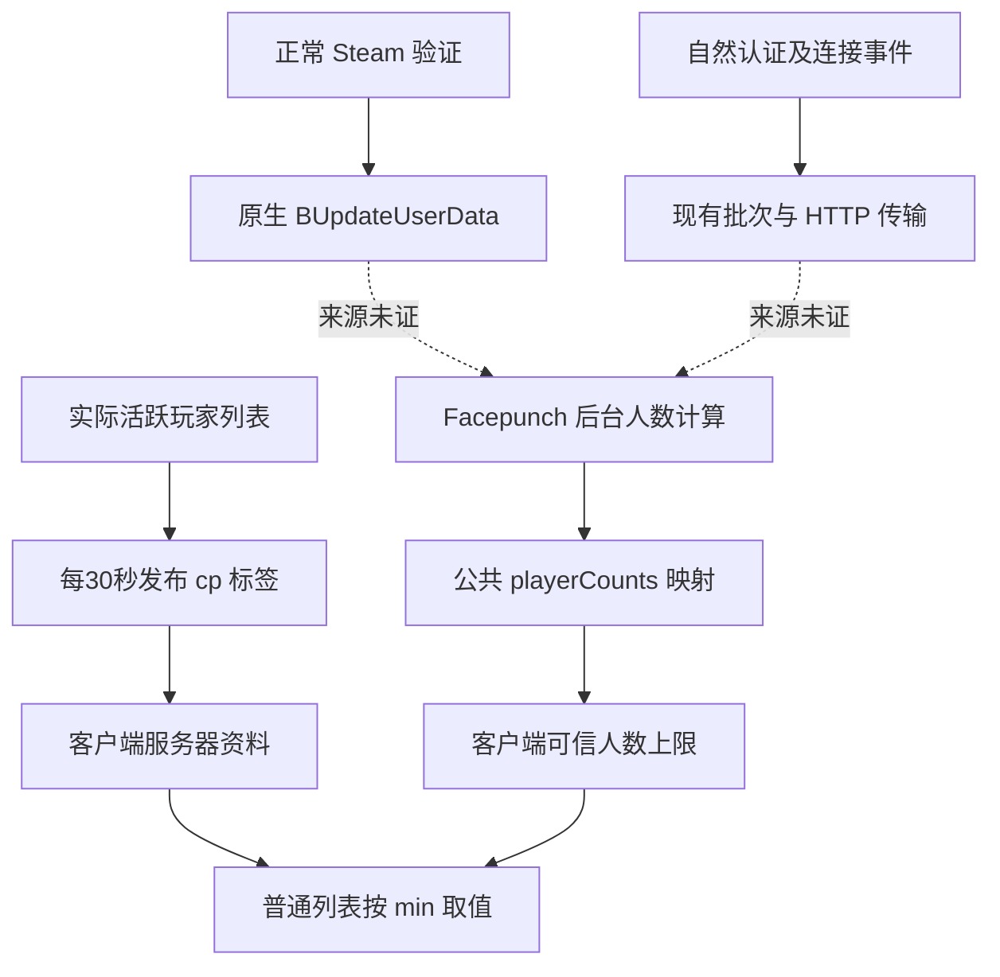

# 公共列表人数：查询、上报与当前未闭环部分

2026-10-24 16点批次。公共人数尚未验证修复。本轮新完成客户端通知链、服务端注册/回调泵/缓存深扫、12次真实并行人数查询，以及本地运行服的实际安全状态读取；没有把诊断 DLL、一次成功返回或自然人数增长当作修复。

## 已恢复的查询与显示链

普通列表先取得 Steam 服务器资料及 `cp`，另通过 `https://api.facepunch.com/api/public/steamServers/playerCounts/rust` 取得游戏 `IP:游戏端口` 到整数的映射。适用普通列表分支使用 `max(0, min(cp, trusted))`。这里查的是 ConnectionPort，不是 QueryPort。客户端一分钟的请求阈值与目前观测到的公共文件约五分钟批次是两件事。

本轮补齐两个细节：

- 请求前检查的是平台 `PublicKey`，随后拼 URL 才调用另一个 `ApiUrl` getter。实际客户端对应 getter 槽位154与148，前者是构建静态值，不是这里读取的账号票据。已修正旧 JSON 将门槛称作 API base 的表述；不公开该静态字面量。
- 成功解析后会发布人数映射并发出通知。浏览器 `OnEnable` 订阅对应回调；在可信上限开启、映射非空的适用分支，回调重新应用人数并标记列表更新；`OnDisable` 解除订阅。关键链为 parser通知 `0x7b44c40` → helper `0x7b41610` → integration slot89 → Action → browser `0x70ecd80` → dirty `0x70ed033`。这些是文件 RVA，不是当前进程地址。

因此“成功回调根本不通知界面，必须再手动刷新一轮”不适合继续作为主要解释。上述通知成立的条件是列表已启用且订阅到对应 integration；本轮没有读取当前 UI 的运行时订阅状态，也没有测量重绘延迟。详情与客户端两文件 SHA 见 `count-client-deep-2026-10-24.json`。

## 已恢复的服务端上报链

虚线表示候选输入，**并未恢复它们到后台人数计算的因果关系**。Steam 认证、服务端 analytics、有效 EAC、账号资格或其他后台来源都不能仅凭时间相近确定。

本轮聚焦12个模块、313个方法和333处调用，并对当前 Managed 目录266个可解析模块作了补充名称/调用扫描。版本哈希、19项结论、方法 token 与 IL 范围见 `count-server-deep-2026-10-24.json`。新增的实际代码事实：

| 代码路径 | 结果与影响 |
| --- | --- |
| `SteamPlatform.StartSteamServer` | 构建初始化参数、注册事件、正常匿名登录服务器后台；初始化与登录分别发生，不等于后台已收录 |
| `ServerMgr.Update → SteamPlatform.Update → SteamServer.RunCallbacks → Dispatch.Frame` | 正常帧循环已有原生手动 callback 泵；不能因看见另一个同名 wrapper 就额外注入泵 |
| `AutomaticHeartbeats` / `AdvertiseServer` | 都转到 `SetAdvertiseServerActive`，名称不代表托管层有一个可调心跳定时器 |
| `SteamServer.ForceHeartbeat` | 当前二进制只有 `IL_0000: ret`；反复调用这个方法没有刷新效果 |
| `GameTags`、MaxPlayers、BotCount、SetKey | 对相同缓存值会跳过原生写入；这是条件性诊断点，尚未观测到缓存失配 |
| 已检查的 Steam 连接/断开处理函数 | 只记录日志，未在这些函数中重放元数据；不证明原生重连丢失数据 |
| 补充扫描中的精确 `SetPlayerCount` | 未找到定义或调用；此负结果不覆盖原生实现、反射、运行时补丁和远端其他代码 |
| analytics 工作线程中的额外 `PlatformService.Update` | 在关闭等待上传任务的分支，不能说常规上传线程一直额外泵 Steam callback |

当前远端 `cp` 在12份样本中都等于 RCON，因此没有证据支持“活跃列表没有发布”。不能据缓存存在或 ForceHeartbeat 这个名字，直接制作重发插件。

## 本轮实际观察及证据分层

15:49:36–15:55:08 北京时间的12份样本，RCON为11→12→11，cp逐份相同，A2S人数多2或3且bots0。公共文件新批次从7变9，而研究 Rust 连接始终为0；名单集合有2次变化。这次增长属于自然观察，不能算研究成功。额外较早基线A2S14/cp10也说明差值不是固定2。完整记录见 `count-chain-observation-2026-10-24.md/.json`。

15:50:18 本地官方加载自写、无补丁的 `CountSnapshot`，首次读到运行值：Steam已登录后台，但实际secure=false、加密等级1、EAC接口不存在、客户端映射0；EAC缓存“已认证”计数却为1。活跃/存活/已醒/已连接各1。官方卸载及复制DLL移出已确认，无配置或玩家操作。详见 `count-snapshot-local-2026-10-24.md/.json`。

这个本地服不能充当有效EAC对照；此前独立程序因加密要求停止，也不能据此称作EAC认证失败。`IsAuthenticated`缓存值与最终EOS token校验需要分开。新工具只加载时读一次，卸载文件复用缓存，不是持续采样。

另重新核对旧12分钟gameplay实验七份原始记录：均DryRun=False，仅FPApi(server)有序列化流；总Uploaded Bytes增加，与分析副本的HTTP成功状态路径相符。`uploaderstats.Total Bytes`本身是序列化字节，外层Upload Task还可能吞网络异常后正常完成，所以不能将Task完成、队列归零或总字节单独当后台采用回执。没有推翻旧窗口，也没有重做配置开关；安全复核见 `count-upload-window-audit-2026-10-24.json`。

## 当前能做到什么，下一步需要什么

现在已经恢复“客户端从哪里查询、怎样应用上限”，以及本地可见“服务器怎样注册、发布活跃数、更新Steam资料、发送自然事件”的链。**Facepunch后台从哪些数据生成trusted、如何筛选账号，仍不在已取得的客户端或服务端文件中。** 没有远端后台源码或逐账号收录回执，不能声称已经摸透全部实现。

下一阶段优先事项：

1. 取得已注册运行服的正规只读诊断部署通路和匹配模块；现有远端仅RCON，无法运行本轮新DLL。当前无需先购买服务器，已有公开服能部署即可提供更多信息。
2. 在同一正常连接生命周期中按内存身份分类关联Steam真实回调、原BUpdateUserData结果、实际secure/EAC句柄/SDK回调来源及EOS token最终结果；公开输出仅阶段计数，不输出身份或认证载荷。
3. 对具体表、具体uploader记录自然上传前后的计数与成功状态类别，避免把总体字节或外层Task当采用回执。只在真实漏发/失败被确认后，研究相应正常修复；不凭猜测反复Flush或重放认证事件。
4. 在正常玩家变化受控的已登记服，配对RCON、cp、A2S、认证人数、多个新trusted批次和正常游戏列表刷新读数，独立重复入服/离服。即便人数相等，也要排除其他玩家和资格变化；目前没有这项验收结果。

若以后使用新公网测试服，关键条件是可注册且可部署诊断、能取得真实正常客户端对照及维护稳定窗口；单独购买机器不会解决后台来源缺口。本地当前仍可做源码及诊断正确性验证，但继续重复非secure本地连接或上传并不能验证公共收录。

本批未执行未知 `FakePlayers.dll`，未修改人数或认证，未向公共接口上传构造数据。Web页面保持运行，当前3个Steam在线、0个研究Rust活动连接；有限采样与诊断已结束，无待卸载模块、账号恢复或配置回滚义务。

发布前通过49项证据一致性/哈希/实际卸载检查、新增及修改公开文件的凭据与身份扫描、6份JSON解析及Git差异检查。CountSnapshot使用当前真实服务端引用离线编译并实际加载；没有重跑与本轮文档及独立诊断无关的Web测试套件。源码、离线编译、单次运行和公共人数效果分别记录，不把这些检查算成人数验收。
