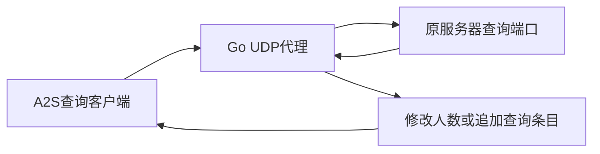

# server-query-fake-player-count 源码复核

2026-10-26。用户提供[项目链接](https://github.com/anatolykopyl/server-query-fake-player-count)。本轮读取默认分支全部6个文件、相关issues及评论、最新发布元数据，以及port-remapping分支差异和main.go。**它是Steam/A2S查询回复代理，未实现Steam账号登录、Rust玩家入服、有效EAC或Facepunch逐账号收录。** 对仅读取A2S的工具可能改变显示，不能由此保证Rust公共人数增加；后台算法仍未知。

复核固定版本：

- 默认master：`ffd3edd24466dc4b40a5521fbc7cc666672947d2`。
- port-remapping：`f0ba3cbea4e7ab015fbe5ea457bd1e6ad9bdd507`，对应未合并的[PR8](https://github.com/anatolykopyl/server-query-fake-player-count/pull/8)。
- latest Release接口返回v1.0.0，发布时间2025-02-23；只读取元数据，没有下载二进制，也没有将该发布等同于本轮master源码。

## 实际处理链

[README](https://github.com/anatolykopyl/server-query-fake-player-count/blob/ffd3edd24466dc4b40a5521fbc7cc666672947d2/README.md#L3)说明它原本用于DayZ，其他游戏“可能”适用。新分支README也明确代理的是查询，监听端口不是游戏连接端口。程序不是Oxide插件或DLL。

| 路径 | 直接源码行为 | 与本项目的关系 |
| --- | --- | --- |
| [main.go:62](https://github.com/anatolykopyl/server-query-fake-player-count/blob/ffd3edd24466dc4b40a5521fbc7cc666672947d2/main.go#L62) | 按请求第5字节选择INFO/PLAYER修改分支，其他类型单次转发回复 | 是查询代理，没有建立Rust玩家生命周期 |
| [main.go:123](https://github.com/anatolykopyl/server-query-fake-player-count/blob/ffd3edd24466dc4b40a5521fbc7cc666672947d2/main.go#L123) | 在INFO回复中定位单字节players，加上配置量后尝试按maxPlayers限制 | 没有解析或改写Rust的cp标签，也未更新真实活跃玩家列表 |
| [main.go:153](https://github.com/anatolykopyl/server-query-fake-player-count/blob/ffd3edd24466dc4b40a5521fbc7cc666672947d2/main.go#L153) | 修改PLAYER条目数，追加空名字、索引0、分数0和固定duration字节的条目 | 查询中出现的记录不是BasePlayer或真实账号连接 |
| 全部已读源码 | 无Steam票据获取/验证、Rust握手/状态同步、EAC模块或Facepunch人数接口 | 不能替代独立程序缺失的受保护会话；无逐账号公共采用回执 |

先前已核对GameDig的Rust路径会采用cp，适用Rust普通浏览器分支还受Facepunch公共映射上限影响；见[网络项目复核](public-count-web-survey-2026-10-25.md)及[查询链](count-query-reporting-deep-2026-10-24.md)。因此不同查询工具可能得出不同数字。**不能把这个代理对某个A2S工具的显示效果当作Facepunch有效玩家认定。** 本轮没有对当前运行客户端重新验证分支或开关。

## 已有问题及代码限制

1. **INFO challenge崩溃线索。** [issue6](https://github.com/anatolykopyl/server-query-fake-player-count/issues/6)报告A2S_INFO challenge导致slice越界；作者在[回复](https://github.com/anatolykopyl/server-query-fake-player-count/issues/6#issuecomment-3735774228)中曾表示自己的实验未正常工作。默认分支INFO修改函数仍没有先检查回复类型/长度；PLAYER函数只有challenge特判，也没有完整长度检查。这是源码和问题记录，不是本轮对真实游戏服的复现。
2. **服务器列表与直接查询可能不同。** [issue5](https://github.com/anatolykopyl/server-query-fake-player-count/issues/5)讨论公布端点与代理不匹配；用户后来报告Project Zomboid只在点击服务器后显示修改值，默认列表仍是真实人数。这是其他游戏的用户反馈，不是Rust/Facepunch成功案例。[issue4](https://github.com/anatolykopyl/server-query-fake-player-count/issues/4)也报告类似浏览器可见性问题。
3. **新分支主要补部署拓扑。** 固定compare中8个文件变化，新增Docker、Compose、CI及说明；完整main.go与master相比仅改一行参数帮助文字，查询逻辑相同。未补Rust cp、EAC或Facepunch收录链。作者在[issue5评论](https://github.com/anatolykopyl/server-query-fake-player-count/issues/5#issuecomment-5280408686)明确说该分支未测试；不能把未合并PR当作已验证修复。
4. **报文和资源处理不足。** 单次请求创建新UDP socket，只读一次1024字节；没有分片重组、压缩解码、读超时或并发上限。较大或分片回复不能被当作一个完整响应解析；上游不回复时处理协程可能持续等待。challenge若绑定源端口，逐请求换socket还可能影响往返；具体绑定规则取决于服务端，未实测。
5. **计数与时长并不可靠。** 人数运算先转换成byte再相加，可能回绕，INFO与PLAYER的限制也不一致。源码生成了随机durations，但没有把它们写入条目，实际追加的是固定字节；全部新增名字为空。不能把这些条目描述成正常账号、实际游戏时长或不同玩家网络延迟。

## 对当前目标的结论

| 目标 | 本项目提供的能力/证据 |
| --- | --- |
| 改变经过代理的A2S回复 | 存在相应实现，但有上述未验证和兼容问题 |
| 给指定账号随机IP或ping | 没有对应实现，不维护逐账号连接 |
| 不启动Rust却真正进服 | 没有对应实现 |
| Rust有效EAC会话 | 没有对应实现 |
| 让Facepunch公共人数采用模拟账号 | 没有相应代码或Rust验证证据，效果不能保证 |

它对研究有用的地方是说明“查询回复人数”可以与“实际玩家/公共统计”分离。不能据项目名称、README中的“reported to Steam”或某个其他游戏截图，认定它改变了Steam认证人数或Facepunch后台。

本轮18次公开HTTP读取，全部200；全部URL、原文哈希、固定源码哈希和关键引用范围见[同名JSON](query-fake-player-count-review-2026-10-26.json)。原始响应保留在workspace ignored `work/query-fake-count-review-20261026/`。没有编译、执行、安装该项目，没有下载Release资产、修改端口/防火墙、登录远程系统、使用服务器凭据或改动本地服务及现有账号连接。
