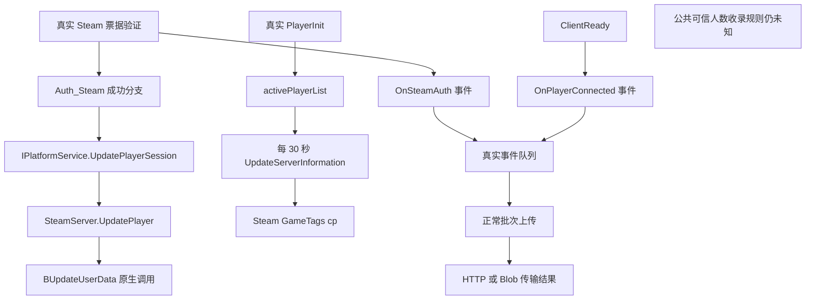

# 服务端正常人数上报路径与插件可行性（2026-10-24）

当前本地服务端存在可由正规插件观察或有条件调用的正常路径：Steam 真实玩家资料更新、服务端信息发布，以及现有真实 analytics 事件的批次调度。**尚未找到能够保证某个已连接账号被 Facepunch 公共可信人数收录的插件入口。** 不能把这些路径的成功等同于列表人数修复。

本轮在阅读已有报告后，重新静态读取了当前 `D:\RustServer\rustds\RustDedicated_Data\Managed` 中的 7 个模块，避免套用更新前的文件哈希和 IL 偏移。仅将文件当作数据分析；没有执行未知 DLL、安装插件、修改配置、建立网络请求或干预正在运行的有限实验。完整哈希、方法定位、候选入口及限制见同名 JSON；原始 IL 只留在忽略目录。

## 当前版本仍然存在的正常链路

图中没有将上传结果连接到公共可信人数，因为这条后台因果链尚未建立。

`Auth_Steam` 成功后调用 `PlatformService.Instance.UpdatePlayerSession`，再进入 `SteamServer.UpdatePlayer`、`BUpdateUserData`。后者返回 `bool`，但公开的 `UpdatePlayer` 包装在 `IL_000D` 丢弃它。当前检查的 7 个模块中，游戏层可见的 `UpdatePlayerSession` 调用仅在 Steam 认证成功分支找到；睡醒和重生路径没有另一次补调。这说明成功返回值是尚未观测到的诊断点，不能说明原调用确实失败。

`PlayerInit` 将玩家加入活跃列表；`StartSteamServer` 建立 2 秒后首次、每 30 秒一次的信息发布。`UpdateServerInformation` 检查 Steam 接口有效后，将实际 `activePlayerList.Count` 写入 `cp` 标签。此处不以睡眠、首个 Tick 或单玩家 EAC 状态筛人数。它没有直接设置 A2S_INFO 的 `players` 字段，因此原生 Steam 查询人数公式仍不在这条托管链中。

Steam 验证回调另有 `RustPlatformHooks.AuthSessionValidated` → `Azure.OnSteamAuth`。`ClientReady` 另有 `Azure.OnPlayerConnected`。两者都提交正常生命周期事件，不能由插件反复人工调用来冒充新的认证或连接。原版聚合和性能记录也会按各自开关、周期记录实际活跃人数；这些逻辑与已验证的 `cp`、Steam 玩家资料链分别存在。

## 可用于下一版正规插件的入口

| 候选 | 已确认的能力 | 验证目的和限制 |
| --- | --- | --- |
| 订阅公开 Steam 事件 | `OnValidateAuthTicketResponse`、`OnSteamServersConnected`、`OnSteamServersDisconnected` 均有公开静态 add/remove | 汇总正常回调结果、时序和 Steam 在线变化；不主动调用回调、不记录票据和身份 |
| 观察原始 `BUpdateUserData` 返回值 | 托管内部包装返回 `bool`；可设计只观察结果的 Harmony postfix | 找到原资料更新是否被拒绝；不跳过原方法、不改参数、不改返回值，也不重复调用。实际打补丁及触发可靠性尚未验证 |
| 一次真实资料补发 | `PlatformService.Instance` 公开，`IPlatformService.UpdatePlayerSession` 公开，最终使用现有 Steam 更新接口 | 仅在确认真实在线、Steam 验证成功且发现原资料更新失败/漏发后，作为单独受控候选。沿用既有显示名称及 `censorplayerlist` 隐私策略；不创建新认证会话。返回包装仍为 void，不保证可信人数变化 |
| 正常信息发布检查 | `ServerMgr.UpdateServerInformation` 仍存在，但为 private，正常周期已有 30 秒调度 | 可先观察原方法调用频率和实际发布内容；只有 `cp` 确认停滞时，才有研究一次原方法触发的理由。当前活跃人数与 cp 已有正常变化，不能据此预期修复可信人数 |
| 调度现有真实 analytics 批次 | `AnalyticsManager.GameplayEventsTableServer` 为公开字段，`AnalyticsTable.Flush()` 为公开方法 | `Flush` 仅将到期时间设为现在，下一轮管理循环可处理现有批次；不造事件、不改人数、不直接保证 HTTP、后台接收或可信人数收录。仅为后续单次候选，本轮未执行 |
| 扩充只读汇总快照 | 现有 `CountDiagnostics` 已可编译；可补充真实 Steam 验证状态分类及上述观察计数 | 先核对运行服版本及插件框架。离线编译、存在 Oxide DLL 或 RCON 可用，不代表插件已部署并运行 |

订阅的 Steam 事件需要在插件卸载时解除。观察范围应只保留计数、时间和结果类别，避免打印实际 SteamID、名字、IP、认证载荷、网址或密钥。`BUpdateUserData` 所在类型/方法为内部可见，普通直接 C# 调用不能取得其返回值；结果观察需要经过检查的补丁目标发现逻辑，并在正常真实客户端生命周期中验证观察是否生效。

`AnalyticsTable.Flush` 的语义比“强制上传成功”窄：它只写 `nextUploadStamp = DateTime.Now`。队列、累积器、所选 uploader、Enabled、DryRun 和管理循环仍共同决定后续动作。默认服务器事件批次为 5 分钟，禁用 uploader 还可能清空积累事件。昨日获准的 12 分钟实验已经出现上传字节增加而多个新可信批次不变，故不能把缩短到期时间当作缺失修复。

## EAC 状态应诊断，不能由插件补写

当前 `EACServer.IsAuthenticated(connection)` 明确检查 SDK 状态字典的值是否为 2。`authStatusEAC == "ok"` 是另一条准入字符串状态：其写入时机受 `strictauth_eac` 分支影响，不能替代上述查询。收到远端认证状态后还会异步执行 EOS ID token 校验；因此 SDK 状态值、完整 token 校验、实际保护会话与公共可信人数仍需分开记录。

`OnFinishLoading` 只在已有 EAC 接口和客户端句柄时调用 `SetClientNetworkState(IsNetworkActive=true)`，不把 SDK 认证状态改成成功。正常 `EnterGame` 已调用它。重复手调这个函数、人工调用 `OnAuthenticatedRemote`、直接改状态字典或重放认证事件，均不能算补齐真实认证，也不能作为本研究的正常上报方案。正规插件可以观察真实回调及其返回结果，不能代替客户端完成认证。

## 与未知 FakePlayers.dll 的区别和仍缺证据

已分析样本的可见入口是 Update 调度、管理员聊天和 Ping 补丁，部分对象操作及 HTTP 发起仍在资源解释器中。没有恢复出它调用上述正常 Steam 资料更新或可信人数后端的完整证据。其容量助手的 `IList` 不兼容只在管理员聊天某分支得到证实；不能据此给后台周期行为下结论，更不能证明它通过正规认证刷新列表。

下一步应先让已授权的正规诊断插件观察正常真实客户端的一次连接全过程，确认：Steam 回调成功 → 原 `BUpdateUserData` 调用及结果 → 正常活跃列表和 `cp` → 真实事件生成、排队和上传结果。先补证据缺口，再决定是否需要上述一次正常资料补发或一次批次调度；这些候选应单独运行，避免与当前有限实验混杂。

仍缺少远端当前模块/运行补丁的准确版本、原生资料更新实际结果、真实 EAC/ID token 最终结果与后台对可信人数的接收/资格判定。即使资料更新返回 true、HTTP 返回成功，也没有单账号可信人数的确认回执。未找到或验证能够让插件直接要求公共可信人数增加的独立接口。本轮没有生成、部署或运行人数修改插件。
